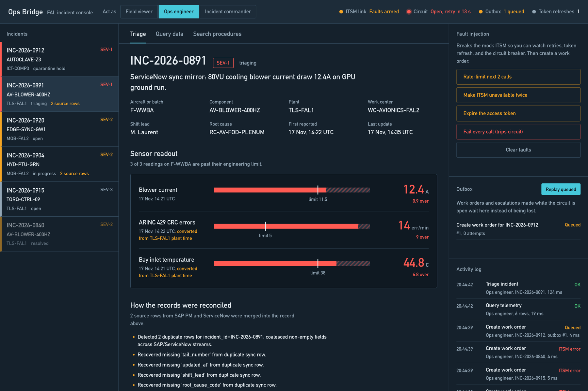

# Ops Bridge MCP

[](https://github.com/fnuvanch/ops-bridge-mcp/actions/workflows/ci.yml)


**A safe bridge between an AI assistant and an aircraft factory's operational systems.** It lets an LLM investigate production incidents (reading sensor data and maintenance procedures) and act on them (opening work orders, stopping an assembly line) with permission checks, audit logging, and failure handling built in.



*The Ops Console during a failure drill: three sensors are over their engineering limits, the ticketing system is failing, so the circuit breaker is open and a new work order is waiting safely in the outbox instead of being lost.*

---

## In 60 seconds

**The problem.** When a fault shows up on an aircraft assembly line, engineers piece together three things by hand: messy sensor and ERP records (duplicated, with gaps and mixed time zones), procedure manuals, and a ticketing system. An AI assistant could speed this up a lot, but giving an LLM access to production systems is risky. It might run a destructive query, open the same ticket five times while retrying, or take an action its user isn't allowed to take, like halting a line that costs about $45k an hour.

**The solution.** A server built on the [Model Context Protocol](https://modelcontextprotocol.io) (MCP, the open standard that lets assistants such as Claude call external tools). It exposes six tools across three systems and puts guardrails around every one:

| System | What the AI can do | Guardrails |
|---|---|---|
| Plant telemetry (SQLite) | Query sensor data and incident history | Read-only connection, SQL keyword filtering, 100-row cap, 2 s timeout |
| Procedure manuals (Markdown SOPs) | Search for the right procedure | Every answer cites the exact section and line numbers |
| Ticketing (ITSM REST API) | Open work orders, escalate line stoppages | Role-based permissions, duplicate-proof retries, circuit breaker, outbox for outages |

**The Ops Console** is a web UI over the same tools, so people can see what the AI sees: incident triage, live sensor gauges, a role switcher to watch permissions apply, and buttons that break the ticketing system on purpose to show the system recovering.

## What this project demonstrates

| Skill | Where to look |
|---|---|
| Secure AI tool design: least privilege, role-based access, signed JWTs | [`src/auth.py`](src/auth.py) |
| Defensive data access: read-only SQL guardrails for LLM-written queries | [`src/connectors/structured_db.py`](src/connectors/structured_db.py) |
| Reliability engineering: idempotency, retries with backoff, circuit breaker, dead-letter outbox | [`src/resilience.py`](src/resilience.py), [`src/connectors/action_api.py`](src/connectors/action_api.py) |
| Search without heavy ML: hybrid full-text + BM25 + n-gram vectors, fused by rank | [`src/connectors/knowledge_base.py`](src/connectors/knowledge_base.py) |
| Data cleaning: de-duplicating records, recovering missing fields, normalizing time zones | [`src/connectors/structured_db.py`](src/connectors/structured_db.py) |
| Full-stack UI: FastAPI backend, dependency-free JavaScript, accessible and responsive | [`console/`](console/) |
| Testing: 58 automated tests plus a live end-to-end failure drill, both run in CI | [`tests/`](tests/), [`scripts/verify_live_stack.py`](scripts/verify_live_stack.py) |

## Design decisions worth talking about

- **The AI can lower its own permissions, never raise them.** Tool arguments come from the LLM, so they're untrusted. The server's configured role (or a signed JWT) sets the ceiling; a per-call `operator_role` can only narrow it.
- **Retries can't create duplicate tickets.** Every write carries a deterministic key, `sha256(incident_id:action)`. However many times an agent retries, the ticketing system returns the original ticket.
- **A bad request doesn't take the system down for everyone.** The circuit breaker opens after 3 upstream failures (timeouts, 5xx) but ignores 4xx client mistakes, so one malformed request can't lock out every other operator.
- **Nothing is lost during an outage.** While the circuit is open, writes go to a persistent SQLite outbox and are replayed after recovery. Failures that will never succeed are dead-lettered instead of retried forever.
- **Degrade, don't fail.** Triage queries the database and the manuals in parallel. If one is down, it returns what it has with a clear warning.
- **Runs fully offline.** No cloud APIs, embedding services, or CDN assets, which suits air-gapped plants. Search is plain Python on a 16 GB laptop.

## Hardening pass

A security and correctness review of the first version found and fixed these issues, each now pinned by a regression test ([`tests/test_regressions.py`](tests/test_regressions.py)):

| Severity | Issue | Fix |
|---|---|---|
| Critical | Any MCP client could act as `incident_commander` by passing `operator_role` in a tool call | That argument can now only narrow the trusted role |
| Critical | A JWT signing secret was hard-coded, so anyone reading the source could forge tokens | No default secret; tokens fail closed and the issuer is verified |
| High | One client's 404s could open the shared circuit breaker | 4xx responses no longer count as upstream failures |
| High | Failed outbox items retried forever; replay during an outage burned retries | Dead-letter queue, and replay waits while the circuit is open |
| Medium | Retrying an already-delivered write during an outage was reported as "queued" | It now returns the original ticket |
| Medium | Safe SQL was rejected (`replace()`, keywords inside strings) and some `LIMIT` forms crashed | String-aware checks and robust `LIMIT` handling |
| Low | Duplicate records merged by insert order; one bad timestamp crashed triage | Freshest record wins; malformed timestamps are tolerated |

## Try it in two minutes

```bash
git clone https://github.com/fnuvanch/ops-bridge-mcp.git
cd ops-bridge-mcp
python3 -m venv .venv && source .venv/bin/activate
pip install -e ".[dev]"
python data/seed_db.py      # build the demo telemetry database
python -m console           # open http://127.0.0.1:8300
```

Then, in the console:
1. Pick **INC-2026-0891**: two conflicting source records have been merged, and three sensors are over their limits.
2. Switch to **Field viewer** and try **Create work order**: it's blocked.
3. Switch to **Ops engineer**, create the work order, then click again: the same ticket comes back, no duplicate.
4. Click **Fail every call**, then create work orders on three other incidents: the circuit opens and the next one waits in the outbox.
5. Click **Clear faults**, wait for the countdown, and click **Replay queued**.

Run the test suite with `pytest`, or the end-to-end drill over a real MCP connection with `python scripts/verify_live_stack.py`.

## Tech stack

Python 3.11+, MCP Python SDK, FastAPI, httpx, Pydantic, SQLite (FTS5), rank-bm25, PyJWT, pytest; vanilla JavaScript and CSS for the console; GitHub Actions for CI.

---

# Technical deep dive

`ops-bridge-mcp` is an MCP server for Forward Deployed Engineers working in air-gapped or strictly regulated aerospace and manufacturing environments. It unifies structured operational telemetry, unstructured SOP runbooks, and mutating ITSM workflows behind a single RBAC-governed, fault-tolerant MCP interface.

## 1. Operational Problem Statement
In Final Assembly Line (FAL) and Part-145 aircraft maintenance operations, incident triage spans three fragmented planes:
1. **Dirty Operational Telemetry (SAP PM / ServiceNow):** Duplicate incident rows from dual-stream RFC/REST sync, missing `tail_number`/`shift_lead` metadata from offline tablets, and plant-local vs. UTC timestamp skew (`TLS-FAL1` CET vs. `MOB-FAL2` CST vs. UTC).
2. **Unstructured Engineering SOPs:** Airworthiness directives, torque/thermal tolerances, and Andon escalation protocols trapped in local Markdown manuals requiring exact section and line-range citations without shipping proprietary IP to external embedding APIs or overloading a 16GB Intel MacBook.
3. **Mutating ITSM Action Gateways:** Work-order creation and P1 line-stoppage escalations where LLM retry loops risk duplicate tickets, transient `429`/`503` spikes stall containment, expired OAuth tokens drop requests, and unauthorized users must be strictly barred from halting production (`> $45k/hr` takt impact).

---

## 2. System Architecture

```text
+-----------------------------------------------------------------------------+
|                        MCP Client / AI Copilot / Inspector                  |
|                    (Context: X-Operator-Role / Env / Args)                  |
+--------------------------------------+--------------------------------------+
                                       | MCP (stdio / SSE / Streamable HTTP)
                                       v
+-----------------------------------------------------------------------------+
|                         src/server.py  (MCPServer/FastMCP)                  |
|  Tools:                                                                     |
|   - query_telemetry              - search_runbooks                          |
|   - diagnose_and_triage_incident - create_work_order                        |
|   - escalate_line_stoppage                                                  |
|  Resources: ops://telemetry/schema | ops://runbooks/catalog | ops://audit/  |
+--------------------------------------+--------------------------------------+
                                       |
          +----------------------------+----------------------------+
          v                                                         v
+-----------------------------+                         +---------------------+
|      RBAC Interceptor       |                         |  Structured JSON    |
|        (src/auth.py)        |                         |   Audit Telemetry   |
|  - field_viewer (RO)        |                         |  (src/telemetry.py) |
|  - ops_engineer (RO + WO)   |                         |  stderr +           |
|  - incident_commander (ALL) |                         |  data/audit.jsonl   |
+--------------+--------------+                         +---------------------+
               | ALLOW
               v
+-----------------------------------------------------------------------------+
|                      Resilience Wrapper (src/resilience.py)                 |
|  - Explicit Timeouts: 2.0s DB/KB | 3.0s REST API                            |
|  - Exponential Backoff + Jitter (HTTP 429 / 503)                            |
|  - Circuit Breaker (Trips @ 3 consecutive failures; Half-Open @ 15.0s)      |
|  - Parallel Triage (asyncio.gather(..., return_exceptions=True))            |
+-------+------------------------------+------------------------------+-------+
        |                              |                              |
        v                              v                              v
+------------------+        +---------------------+       +-------------------+
| Plane 1: Struct. |        | Plane 2: Unstruct.  |       | Plane 3: Mutating |
| Telemetry (RO)   |        | Knowledge Base (RO) |       | Action API (R/W)  |
| structured_db.py |        | knowledge_base.py   |       | action_api.py     |
| - SQLite ?mode=ro|        | - SQLite FTS5       |       | - SHA-256         |
| - Keyword block  |        | - rank-bm25         |       |   Idempotency-Key |
| - LIMIT 100 cap  |        | - Char 3-gram vecs  |       | - OAuth 401 auto  |
| - Dup & TZ fix   |        | - Exact Lstart-Lend |       |   token refresh   |
+--------+---------+        +----------+----------+       +---------+---------+
         |                             |                            |
         v                             v                            v
  data/ops_telemetry.db         data/runbooks/*.md         mock_itsm_api/server.py
  (incidents, work_orders,      (5 Aerospace/Mfg SOPs)     (FastAPI w/ chaos &
   component_telemetry)                                     idempotency store)
```

---

## 3. Hardware & Compliance Constraints
- **16GB Intel MacBook Friendly:** Zero PyTorch/GPU/transformer runtime overhead. Unstructured retrieval combines SQLite FTS5 (`porter unicode61`), `rank-bm25`, and lightweight pure-Python character 3-gram + term vector cosine similarity fused via Reciprocal Rank Fusion (RRF).
- **Read-Only Telemetry Isolation:** `structured_db.py` opens SQLite in `file:...?mode=ro` URI mode with `PRAGMA query_only = ON`, blocks SQL comments (`--`, `/* */`), blocks stacked `;` statements, rejects mutating/admin keywords (`INSERT`, `UPDATE`, `DELETE`, `DROP`, `ALTER`, `ATTACH`, `PRAGMA`, etc.), enforces `LIMIT <= 100`, and invokes `conn.interrupt()` on 2.0s timeout.
- **Deterministic Idempotency & Persistent DLQ Outbox:** `create_work_order` and `escalate_line_stoppage` require an explicit `idempotency_key` (e.g., `sha256(f"{incident_id}:{action_type}")`) transmitted via `Idempotency-Key` header and request body so LLM retry loops never spawn duplicate ITSM tickets. When the circuit breaker is `OPEN`, blocked mutations persist to SQLite (`data/action_outbox.db` via `ActionOutboxStore`) and can be replayed via `replay_outbox_actions` after recovery.
- **Cryptographic JWT RBAC Verification:** `src/auth.py` validates HS256 JWT tokens (`X-Operator-Token` / `OPS_OPERATOR_JWT` via `PyJWT`, issuer-checked) before falling back to `X-Operator-Role` / `X_OPERATOR_ROLE`. There is no built-in signing secret: `OPS_JWT_SECRET` must be set, otherwise any presented token fails closed.
- **Least-Privilege Role Ceiling:** the per-call `operator_role` tool argument is supplied by the MCP client/LLM and is untrusted, so it can only *narrow* the server's trusted role (e.g. an `incident_commander` session acting as `field_viewer`), never widen it.
- **Stdio Protocol Safety:** Structured JSON audit logs write strictly to `sys.stderr` and `data/audit.jsonl`, never polluting `sys.stdout`.

---

## 4. Security & RBAC Permission Matrix

| Operator Role (`X-Operator-Role` / JWT `role`) | `query_telemetry` | `search_runbooks` | `diagnose_and_triage_incident` | `create_work_order` | `replay_outbox_actions` | `escalate_line_stoppage` |
|---|:---:|:---:|:---:|:---:|:---:|:---:|
| `field_viewer` (default) | ALLOW | ALLOW | ALLOW | DENY | DENY | DENY |
| `ops_engineer` | ALLOW | ALLOW | ALLOW | ALLOW | ALLOW | DENY |
| `incident_commander` | ALLOW | ALLOW | ALLOW | ALLOW | ALLOW | ALLOW |

Unauthorized invocations return a structured `RBAC_FORBIDDEN` MCP error payload without crashing the server and emit a `DENY` audit record.

---

## 5. FDE Operations Runbook

### Repository Layout
```text
ops-bridge-mcp/
├── pyproject.toml
├── .github/workflows/ci.yml     # Tests + live MCP drill on Python 3.11 and 3.12
├── docs/console.png
├── mcp_config.example.json      # MCP client host config template (copy to mcp_config.json)
├── README.md
├── mock_itsm_api/
│   └── server.py
├── console/                     # Local web Ops Console (FastAPI + vanilla JS, no CDN assets)
│   ├── app.py
│   └── static/
├── scripts/
│   └── verify_live_stack.py     # Live MCP stdio + HTTP /admin/chaos E2E drill
├── data/
│   ├── seed_db.py               # Telemetry + historian_rollups + FTS5 runbook index
│   └── runbooks/
├── src/
│   ├── server.py
│   ├── auth.py
│   ├── resilience.py
│   ├── telemetry.py
│   └── connectors/
│       ├── structured_db.py
│       ├── knowledge_base.py
│       └── action_api.py
└── tests/
    ├── test_rbac.py
    └── test_resilience.py
```

### Quickstart & Verification
```bash
# Create a virtual environment and install (with test dependencies)
python3 -m venv .venv && source .venv/bin/activate
pip install -e ".[dev]"

# 1. Seed SQLite operational DB (dirty telemetry, historian_rollups & FTS5 runbook index)
python data/seed_db.py

# 2. Launch Mock ITSM API in background (port 8100)
uvicorn mock_itsm_api.server:app --host 127.0.0.1 --port 8100 &

# 3. Run RBAC, JWT, SQL guardrail, OAuth refresh, idempotency, DLQ & circuit breaker tests
pytest -v

# 4. Run full live MCP stdio + HTTP chaos drill end-to-end
python scripts/verify_live_stack.py

# 5. Launch MCP Inspector for interactive verification
mcp dev src/server.py

# 6. Launch the Ops Console web UI (embedded mock ITSM, no second server needed)
python -m console            # http://127.0.0.1:8300
```

### Ops Console
`console/` is a local web UI over the same MCP tool functions an LLM client calls, so every click goes through RBAC, the SQL guardrails, idempotency keys, the circuit breaker, the DLQ outbox, and the audit trail.

- **Incident board and triage:** reconciled SAP/ServiceNow records, ECAM-style sensor gauges against engineering limits, and ranked SOP sections whose citations expand to the exact source lines.
- **Role switcher:** act as field viewer, ops engineer, or incident commander and watch mutations get allowed or blocked.
- **Fault injection:** rate limits, 503s, token expiry, and a hard-failure mode that trips the circuit breaker; the status strip shows the breaker countdown, queued outbox items, and token refreshes live.
- **Activity log:** the structured audit trail, streaming as you work.

The role switcher is a demo control that sets the trusted operator context directly, so the console binds to `127.0.0.1` and is not an authentication layer. It uses no external fonts or scripts, so it works air-gapped. Use `python -m console --itsm-url http://127.0.0.1:8100` to drive a separately running mock ITSM instead of the embedded one.

### Chaos Testing `mock_itsm_api`
You can inject live fault scenarios against the running mock ITSM service:
```bash
# Inject 2x HTTP 429 rate limits and 250ms latency spike
curl -X POST http://127.0.0.1:8100/admin/chaos \
  -H "Content-Type: application/json" \
  -d '{"fail_next_429": 2, "latency_ms": 250}'

# Force token expiration on next call to verify automatic 401 OAuth refresh
curl -X POST http://127.0.0.1:8100/admin/chaos \
  -H "Content-Type: application/json" \
  -d '{"force_401_once": true}'

# Reset chaos state
curl -X POST http://127.0.0.1:8100/admin/chaos \
  -H "Content-Type: application/json" \
  -d '{"reset": true}'
```
